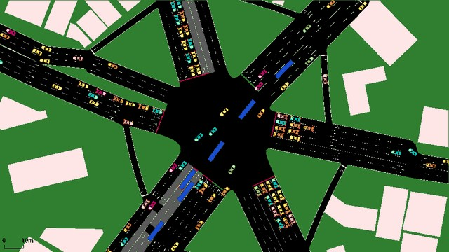

# HexaCross: Teaching a Self-Driving Car to Cross Busan's Six-Way Yeonsan Junction

Seungjun Lee, Jiwon Seo, Seoyoung Hwang, Hoseop Lee, Jimin Cheon<br>
Sungkyunkwan University (SKKU)

[Project page](https://jimin326.github.io/HexaCross/) · [Dataset](https://huggingface.co/datasets/hoseob0902/HexaCross-dataset) · [Slides](https://jimin326.github.io/HexaCross/slides/HexaCross_final.pdf) · [Video](https://jimin326.github.io/HexaCross/#video)



We rebuilt Busan's Yeonsan junction, where six roads meet, in the SUMO traffic simulator and trained an autonomous vehicle (AV) to drive a 6.7 km loop through it. The AV first imitated an expert driver (behavior cloning, then DAgger) and was then fine-tuned with reinforcement learning (PPO). In 960 evaluation runs the final policy reached its destination 99.38% of the time, with a 0.42% collision rate.

## Overview

- **Road.** The network comes from OpenStreetMap. The 34 lanes around the junction were redrawn against street view. The signal plan has 6 phases in a 120 s cycle; we designed it because the real plan is not public.
- **Traffic.** 4,507 vehicles per hour cross the junction, following Busan's 2025 traffic survey. Another 4,550 vehicles per hour drive on the roads along the loop.
- **AV.** Every 0.5 s the AV reads a 56-dimensional observation and outputs an acceleration and a lane change.
- **Training.** The AV imitates SUMO's driver model (BC, then DAgger) and is then fine-tuned with PPO plus an imitation loss.

## Results

Final model `models/yeonsan_loopB_RL4` on the 6.7 km loop (13 signalized junctions). 4 traffic conditions × 240 runs = 960 runs, deterministic policy.

| Metric | Result |
|---|---|
| Arrival | 954 runs (99.38%) |
| Collision | 4 runs (0.42%) |
| Red-light violation | 2 runs (0.21%) |
| Stopping position (median) | 4.5 m behind the car ahead, 1.6 m before the stop line |

Results per traffic condition and the training steps are in [`models/yeonsan_loopB_RL4/README.md`](./models/yeonsan_loopB_RL4/README.md).

## Installation

Tested with Python 3.12 and SUMO 1.27.1. SUMO is installed by `requirements.txt` (the `eclipse-sumo` package).

```bash
git clone https://github.com/jimin326/HexaCross && cd HexaCross
python -m venv .venv && source .venv/bin/activate    # Windows: .venv\Scripts\activate
python -m pip install -r requirements.txt
```

- In Windows PowerShell, set environment variables first, for example `$env:ROUTE_SET = "loopB"`, then run the `python …` command.
- If another SUMO version is already installed, set `SUMO_HOME` as described in the comments of `requirements.txt`.

## Evaluation

Evaluate the final model on the loop, 240 runs per traffic condition:

```bash
ROUTE_SET=loopB MAX_STEPS=6000 LANE_PLAN_RANGE=300 ROAD_DETAILS=driver_styles,taxi,short_stops \
python tools/rl/eval_parallel.py models/yeonsan_loopB_RL4/model.pt results/eval_RL4 --n 240 --workers 4 --chunk 15
```

Open the road and the traffic flows in `sumo-gui`:

```bash
python view_road.py
```

How to re-record the driving video: [`docs/videos/loopB_RL4/README.md`](./docs/videos/loopB_RL4/README.md).

## Dataset

10,647,162 transitions from 3,600 episodes, on [Hugging Face](https://huggingface.co/datasets/hoseob0902/HexaCross-dataset). Each row pairs the AV's partial observation with the simulator's privileged state. The data was collected with the `models/yeonsan_loopB_RL2` policy.

```python
import pandas as pd
url = "hf://datasets/hoseob0902/HexaCross-dataset/v2/loopB/loopB_RL2_s11.parquet"
df = pd.read_parquet(url)
```

Collect one shard yourself (seed 11, 400 episodes; the command that made the released data):

```bash
ROUTE_SET=loopB MAX_STEPS=6000 LANE_PLAN_RANGE=300 ROAD_DETAILS=driver_styles,taxi,short_stops \
python collect_pomdp_data.py --model models/yeonsan_loopB_RL2/model.pt --episodes 400 --workers 4 --seed 11 --name loopB_RL2_s11
```

Column definitions: [`DATA_FORMAT.md`](./DATA_FORMAT.md).

## Models

| Folder | Description |
|---|---|
| `models/yeonsan_loopB_RL4` | **Final model.** Stops at the right distance from the stop line and the car ahead |
| `models/yeonsan_loopB_RL2` | Retrained after the speed-limit clip on actions was removed. The policy that collected the released dataset |
| `models/yeonsan_loopB_RL3` | Retrained after a seed bug in the evaluation script was fixed |
| `models/yeonsan_loopB_RL` | First single-network model to complete the loop (sr1) |
| `models/yeonsan_loopC_RL` | Model for a second loop with more left turns |
| `models/yeonsan_7routes_*` | Early experiments on 7 routes through the junction (PPO, BC, DAgger ensemble) |

## Repository structure

```
HexaCross/
├── env/                    # SUMO environment
│   ├── road_config.py      #   road, AV and background-vehicle settings
│   ├── mdp_config.py       #   observation, action and reward settings
│   ├── sumo_env.py         #   Gymnasium environment, TraCI control
│   ├── maps/               #   Yeonsan junction and the surrounding network
│   └── demand/             #   traffic demand from Busan's 2025 survey
├── algorithms/             # PPO, BC, ensemble and residual policies
├── utils/                  # networks, buffers, evaluation, logging
├── tools/
│   ├── rl/                 #   imitation learning, DAgger, PPO training, evaluation, video recording
│   ├── data/               #   Parquet conversion, checks, Hugging Face upload
│   └── *.py                #   network building and validation
├── models/                 # model of each stage with its evaluation (README in each folder)
├── checkpoints/            # intermediate models from the experiments
├── docs/                   # project page (GitHub Pages), experiment logs, road survey, videos
├── collect_pomdp_data.py   # driving-data collection
├── train.py, train_bc.py   # baseline PPO and BC training
├── test.py, view_road.py   # watch a model drive, view the road
├── DATA_FORMAT.md          # dataset column definitions
├── data/, results/         # sample data and a sample training run (new outputs are not tracked)
└── requirements.txt
```

The SUMO files in `env/sumo/` are regenerated from `env/road_config.py` each time a script runs.

## Documentation

The documents below are written in Korean.

| Document | Content |
|---|---|
| [`DATA_FORMAT.md`](./DATA_FORMAT.md) | Dataset columns, the 56-dimensional observation, how the data was collected |
| [`models/yeonsan_loopB_RL4/README.md`](./models/yeonsan_loopB_RL4/README.md) | Training and evaluation of the final model |
| [`docs/experiments/loopB_log.md`](./docs/experiments/loopB_log.md) | Training log for the loop (2026-11-21 to 11-27) |
| [`docs/experiments/README.md`](./docs/experiments/README.md) | Early experiments on 7 routes (2026-11-17 to 11-22) |
| [`env/maps/README.md`](./env/maps/README.md) | How the road network was built and checked |
| [`env/demand/README.md`](./env/demand/README.md) | Traffic demand data |

## Acknowledgements

- Built on the starter code of the Autonomous Driving AI and Control course at Sungkyunkwan University: [bmil-ssu/Artificial-Intelligence-and-Control-for-Autonomous-Driving](https://github.com/bmil-ssu/Artificial-Intelligence-and-Control-for-Autonomous-Driving)
- Map data © OpenStreetMap contributors
- Traffic demand: Busan's 2025 traffic survey
- Simulator: [Eclipse SUMO](https://eclipse.dev/sumo/) 1.27.1
