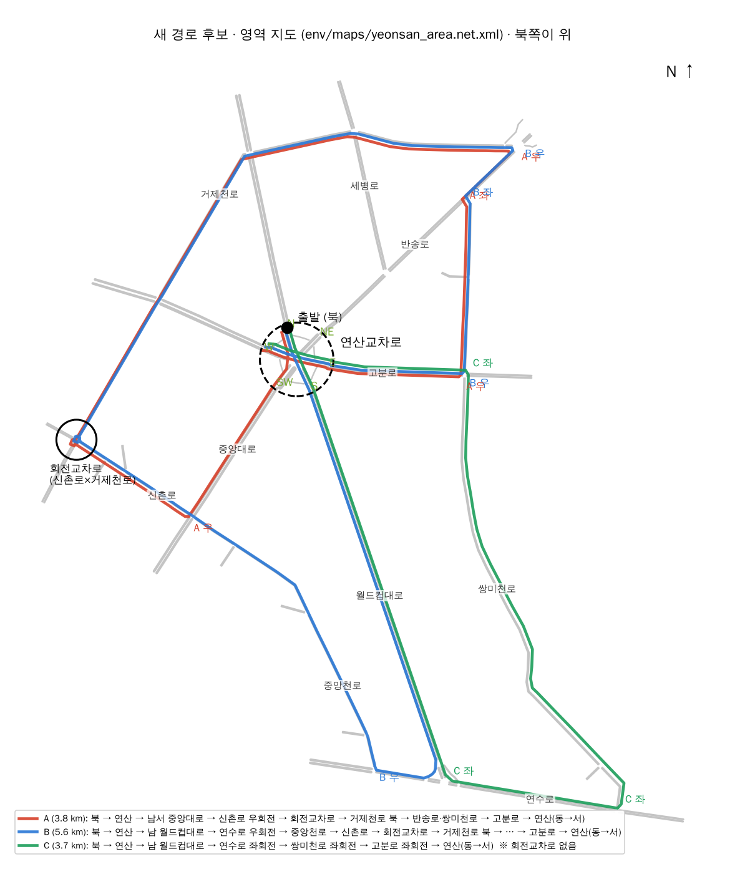

# yeonsan_loopB_RL: 루프 경로 B (모방학습 → 강화학습)

연산교차로 북쪽에서 출발해 연수로·회전교차로를 돌아 연산교차로 동쪽으로 다시 들어와 서쪽으로 나가는 루프 경로 B를 학습한 **단일 신경망**이다 (앙상블 아님). 모방학습으로 초기화한 뒤 PPO 강화학습으로 180만 스텝 학습했다.



## 결과 (교통량 1.0, 결정적 정책, 480회)

| 평가 | 완주 | 충돌 | 신호위반 | 차로 오류 |
|---|---|---|---|---|
| 시드 921~954 (240회) | 99.17% | 0.42% (1) | 0.42% (1) | 0% |
| 시드 961~994 (240회) | 99.58% | 0% | 0.42% (1) | 0% |
| **합계 480회** | **99.38%** | **0.21% (1)** | 0.42% (2) | 0% |
| 목표 | 97% 이상 | 1% 이하 | | |

같은 조건에서 모방학습 시작점(`il_init_m3.pt`, 240회) 결과는 다음과 같다.
- 완주 98.33%, 충돌 0.42%, 차로 오류 1.25%.
- 강화학습이 차로 오류를 없애고 완주율을 올렸다.

## 경로와 지도

| 항목 | 내용 |
|---|---|
| 지도 | `env/maps/yeonsan_area.net.xml` (대로 중심 넓은 지도) |
| 경로 | 연산 N 진입 → 월드컵대로 남쪽 → 연수로 4거리(맨 오른쪽 차로에서 우회전) → 중앙천로 → 신촌로 → 회전교차로(신촌로×거제천로) → 거제천로 북쪽 → 세병로/반송로 → 쌍미천로 → 고분로 → 연산 E 진입 → W 진출 |
| 길이 | 38개 도로, 6,666 m |
| 설정 | `tools/rl/routes7.py`의 `ROUTE_SET=loopB` (경로 1개 = `ego_0`, `N_ROUTES=1`) |
| 에피소드 길이 | `MAX_STEPS=6000` (3,000초) |

## 만든 과정

1. **DAgger 1차**
   - J8이 운전하고, 절반의 스텝은 SUMO가 차로를 정했다.
   - 기존 모델은 월드컵대로 → 연수로 우회전 차로를 몰라 0% 완주였다.
2. **황색 신호 정답 보정** (`tools/rl/relabel_yellow.py`)
   - SUMO 정답은 황색 신호 30~70 m 앞에서 "계속 진행/가속"이라, 따라 하면 적색에 진입한다.
   - 정지선까지 4 m/s² 이하로 설 수 있으면 정지, 못 서면 통과로 바꿨다.
3. **모방학습** (`bc_hybrid`, 8개 학습)
   - 그중 단일 신경망 m3(`il_init_m3.pt`)을 시작점으로 골랐다.
4. **PPO 강화학습 sr1** (`tools/rl/residual_train.py`, `INIT_MODEL`)
   - 모방학습 손실 가중치를 1 → 0.1로 줄여 강화학습이 점점 주도하게 했다.
   - 충돌·신호위반 직전 장면에서 30% 다시 시작했다 (`DANGER_RED=1`).
   - 1,802k 스냅샷을 채택했다.

자세한 기록은 저장소 루트의 `진행상황.md`에 있다.

## 파일

| 파일 | 내용 |
|---|---|
| `model.pt` | 채택 모델 (HybridActorCritic state_dict, sr1 1,802k 스텝) |
| `il_init_m3.pt` | 강화학습 시작점 (모방학습만) |
| `bc_lby.npz` | 강화학습 때 함께 쓴 모방학습 손실 데이터 (루프 DAgger 1·2차, 황색 보정, 차로 변경 보강) |
| `sr1_config.json` | 학습 설정 (환경 변수, 하이퍼파라미터, 보상) |
| `sr1_train.txt`, `sr1_train_log.csv` | 학습 로그 |

## 평가

```bash
ROUTE_SET=loopB MAX_STEPS=6000 LANE_PLAN_RANGE=300 SEED=921 \
python tools/rl/eval_routes.py models/yeonsan_loopB_RL/model.pt <SUMO 작업 폴더> 15 out.json
```

SUMO 작업 폴더는 `ROUTE_SET=loopB`를 켠 상태에서 `road_builder.build`로 만든다. `residual_train.py`는 첫 실행 때 자동으로 만든다.

## 강화학습 다시 돌리기

```bash
ROUTE_SET=loopB N_ROUTES=1 MAX_STEPS=6000 LANE_PLAN_RANGE=300 OBS_VISIBILITY=100 LANE_ARROWS=1 INTERNAL_OBS=1 \
INIT_MODEL=models/yeonsan_loopB_RL/il_init_m3.pt BC_DATA=models/yeonsan_loopB_RL/bc_lby.npz BC_W=1.0 BC_W_END=0.1 \
BC_STEPS=20 BC_BATCH=512 LR=3e-5 INIT_LOG_STD=-1.5 LANE_ENT=0 VALUE_WARMUP=20 DANGER_P=0.3 DANGER_RED=1 RING_EVERY=4 RING_N=6 \
REWARD_PATCH='{"collision_penalty": 50.0, "red_light_penalty": 30.0, "wrong_lane_penalty": 10.0, "ttc_penalty": 0.3}' \
N_ENVS=4 STEPS_PER_ENV=1024 TIMESTEPS=2000000 SNAP_EVERY=200000 SEED=41 \
python tools/rl/residual_train.py sr1
```

## 주의

- 스냅샷마다 성능 편차가 크다. 같은 학습 안에서도 60회 평가 기준 95~98%가 오갔다.
  - 60회 평가는 1회 차이가 1.7%p라 목표 판정에 부족하다. 후보는 240회 이상으로 확인한다.
- 같은 학습의 최종 스냅샷(2,002k)은 240회 기준 충돌 1.25%로 목표를 넘지 못했다. 최종 스냅샷이 항상 최선이 아니다.
